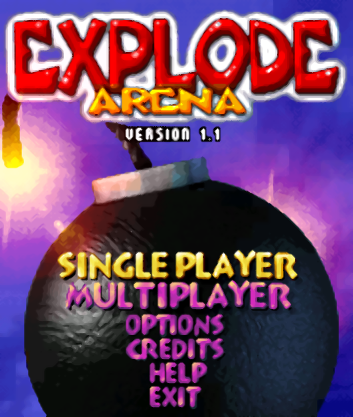
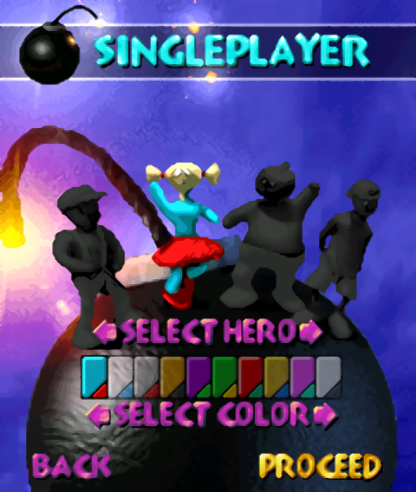
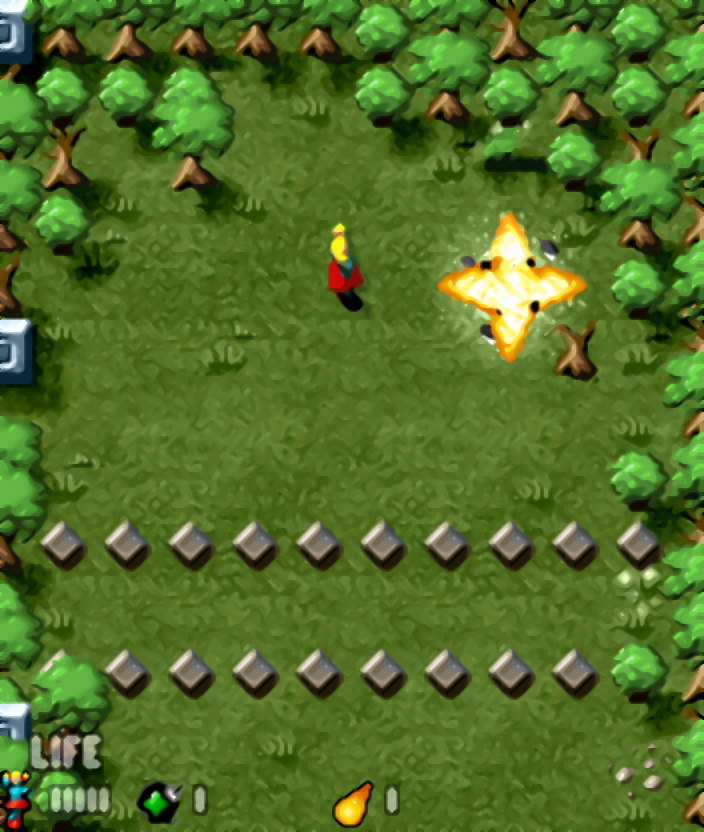
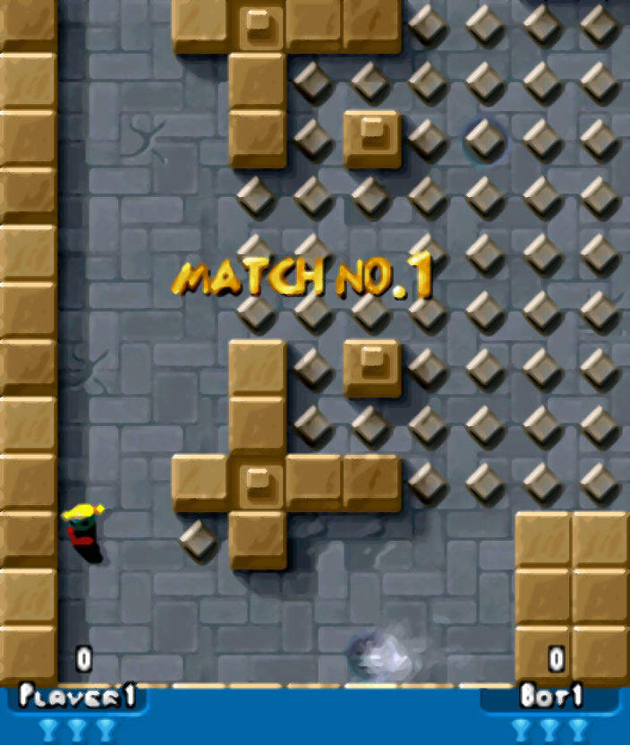

# Explode Arena (Symbian S60) — ARMv4T WebAssembly VM & Reverse Engineering Studio

**Live Web Studio:** **[https://www.agusibrah.im/explode-arena-s60-web/](https://www.agusibrah.im/explode-arena-s60-web/)**

A clean-room, **zero-game-data** WebAssembly port and reverse-engineering studio for **Explode Arena (v1.10, Symbian OS EPOC Release 6 / Nokia Series 60)** originally developed by **Infinite Dreams (2004)**.

Instead of re-implementing an approximation of the game logic, this project executes the **original unmodified ARMv4T 32-bit machine code (`ExplodeArena.app`)** directly in the browser via a custom **22 KB WebAssembly Virtual Machine (`src/vm.c` → `vm.wasm`)** paired with **Symbian S60 High-Level Emulation (HLE)**, a **5-stage `De-Dither + 21-Tap xBR + Anime4K` 4× HD upscaler (`176×208` → `704×832`)**, and a **Hi-Fi 16 kHz 12-channel ProTracker MOD + WAV audio pipeline**.

> **Important Legal & Copyright Disclaimer (Bring Your Own `.SIS`):**
> This repository contains **NO copyrighted game binaries (`.app`), asset archives (`data.pak`), audio files (`.mod` / `.wav`), or installation packages (`.sis`)**. It provides only the clean-room ARMv4T WebAssembly Virtual Machine, Symbian S60 HLE shim, and client-side `.sis` parser.
>
> To play, you must obtain your own copy of the Symbian S60 **`Explode_Arena.sis`** installation file (`UID1 = 0x10015B92`, EPOC Release 6) from your personal backup or public mobile software preservation archives on the internet, and drop it onto the web interface. Everything is unpacked and executed 100% locally in your browser.
>
> *Explode Arena* (© 2004) is the intellectual property of **Infinite Dreams Inc.** and **Element Studio** (music by **Falcon / Cloud#9^AP**). All rights to the original game software, graphics, characters, and audio belong to their respective copyright holders.

---

## 4× HD Upscaled Screenshots (`176×208` → `704×832` via 5-Stage `De-Dither + 21-Tap xBR + Anime4K`)

| Main Menu (`menu.lvl002.dat`) | Hero & 10-Color Selection (`menu.lvl003.dat`) |
| :---: | :---: |
|  |  |
| **Arcade Campaign (`explodearena.lvl003.dat`)** | **Bot Deathmatch Arena (`explodearena.lvl000.dat`)** |
|  |  |

---

## Key Features

- **100% Authentic ARMv4T Execution:** Runs the original Symbian E32 binary (`ExplodeArena.app`), preserving exact bot AI, physics, menus, campaign scripts, and multiplayer modes (*Arcade*, *Deathmatch*, *Last Man Standing*, *Capture The Flag*, *Domination*).
- **Client-Side `.SIS` & `data.pak` Unpacker (`js/sis_parser.js`):** Parses Symbian EPOC Release 6 `.sis` headers, decompresses RFC 1950 zlib streams in pure JavaScript, decodes the XOR `0xAA`-obfuscated `data.pak` directory table, and resolves all **98 asset filenames** using the recovered hash function (`0x1000C05C`).
- **5-Stage 4× HD Graphics Upscaler (`176×208` → `704×832`):**
  1. **Edge-Preserving Bilateral De-Dithering:** Eliminates 4-bit/8-bit Symbian checkerboard dithering and color banding while locking sharp outlines.
  2. **Full 5×5 21-Tap xBR Level-2 (2× Pass to `352×416`):** Reconstructs 45° (`1:1`), 26.5° (`1:2`), and 63.4° (`2:1`) slopes in perceptual YUV space.
  3. **Anime4K Directional Push & Sobel Tangent Anti-Aliasing (`352×416`):** Pushes subpixels along iso-contour tangents to smooth curves and thin blocky outlines.
  4. **Second 5×5 21-Tap xBR Pass (`352×416` → `704×832`):** Doubles resolution to `704×832`.
  5. **Final Anime4K Contour Refinement (`704×832`):** Produces clean, vector-like HD visuals suitable for large displays.
- **Enhanced 12-Channel Audio Engine (`soundtrack.mod` + 15 `.wav` SFX):**
  - Hooks the internal channel mixer (`0x10007310`) with **16.16 fixed-point sub-sample linear interpolation** and **16-bit signed saturation (`-32768..32767`)** to eliminate integer wrap-around distortion.
  - Streams into WebAudio via a **4-point Hermite cubic resampler**, **Warm Low-Shelf EQ (+3.5 dB @ 145 Hz)**, **Butterworth Anti-Hiss Lowpass Filter (6.8 kHz)**, and **Soft-Knee Dynamics Compressor**.
- **Authentic Screen Transitions & Mask Wipes (`0x1000A5EC` & `0x1000A818`):** Executes the original RGB565 per-pixel brightness fade-in/fade-out (`0x1000A5EC`) and 2D affine-transformed `mask1.raw`/`mask2.raw` splash wipe transitions (`0x1000A818`).
- **Symbian Bluetooth Multiplayer Bridged to Modern Web/LAN Netplay (`0x1002D570..0x1002E0A4`):**
  - Intercepts the low-level Symbian Bluetooth RFCOMM/SDP transport (`CBTTransport`) while keeping the original 11-state lockstep multiplayer engine (`CMultiplayer` at `0x10040BC4`) 100% intact.
  - Supports **Same-PC Multi-Tab (`BroadcastChannel`)**, **Cross-Device P2P Room Codes (`WebRTC DataChannel`)**, and **Offline Local Network WebSockets (`tools/lan_relay.js`)**.
- **Dual Save System (`game.cfg` Auto-Sync + Instant VM Save States):**
  - **Real-Time Native `game.cfg` Persistence:** Monitors the 104-byte configuration struct at `cgame + 4` every frame and automatically syncs changes (player name, keybindings, audio settings, unlocked campaign stages) to `localStorage` (plus `.cfg` file Import/Export).
  - **Instant VM Save States:** Save and restore the entire ARMv4T VM state (RAM, heap, framebuffer, CPU registers) across 2 browser slots (`IndexedDB`, shortcuts `F5` / `F8`) or export/import `.sav` snapshot files.

---

## System Architecture

```
┌──────────────────────────────────────────────────────────────────────────┐
│                          Browser Frontend (index.html)                   │
│  • Client-Side .SIS Parser (js/sis_parser.js)                            │
│  • 704×832 HD Canvas + Theater/Fullscreen Modes                          │
│  • WebAudio Hermite Cubic Resampler + Mastering EQ/Compressor            │
│  • Save Manager (localStorage game.cfg + IndexedDB VM Save States)       │
└───────────────▲────────────────────────▲─────────────────────┬───────────┘
                │ RGBA8888 (704×832)     │ PCM16 (16 kHz)      │ ScanCodes
┌───────────────┴────────────────────────┴─────────────────────▼───────────┐
│                      WebAssembly Core (src/vm.c → vm.wasm)               │
│                                                                          │
│  1. ARMv4T 32-Bit CPU Interpreter (run_arm)                              │
│     Executes ExplodeArena.app machine instructions at 0x10000000..       │
│     over a 16 MB virtual address space (0x10000000 - 0x10FFFFFF).        │
│                                                                          │
│  2. Symbian S60 High-Level Emulation (HLE) Interceptor                   │
│     • 0x1000B97C / 0x1000BAE8 ──► Virtual VFS reading data.pak & game.cfg│
│     • 0x1000BC0C              ──► Virtual VFS writing 104B game.cfg      │
│     • 0x1004207C / 0x1004239C ──► Coalescing Free-List Heap Allocator    │
│     • 0x10042C8C              ──► CFbsBitmap::DataAddress (0x10200000)   │
│     • 0x10042CEC              ──► HAL::Get (Nokia 6600 UID 0x101FB3DD)   │
│     • 0x10041E9C..0x1004238C  ──► ESTLIB C/String/Math/Float (__divsf3)  │
│     • 0x10007310              ──► Interpolated + Saturated Audio Mixer   │
│                                                                          │
│  3. 5-Stage 4× HD Upscaling Pipeline (update_rgba_fb)                    │
│     176×208 RGB565 ──► Bilateral De-Dither ──► 21-Tap xBR ──► Anime4K    │
└──────────────────────────────────────────────────────────────────────────┘
```

---

## Reverse Engineering Notes

### 1. Symbian EPOC Release 6 `.SIS` Package Structure
The installation package (`Explode_Arena-87690-mobiles24.sis`, 547,961 bytes) targets `Series60ProductID` (`0x101F6F88`):
- **`UID1` (App UID):** `0x10015B92`
- **`UID2`:** `0x10003A12`
- **`UID3` (SIS Magic):** `0x10000419` (EPOC Release 6)
- **File Records (`pfiles = 0x66`, 5 files compressed with RFC 1950 `zlib`):**

| Index | Destination Path on Symbian | Uncompressed | Compressed | Description |
|---|---|---|---|---|
| 0 | `!:\system\apps\ExplodeArena\data.pak` | 409,088 B | 401,593 B | Main game asset archive (98 entries) |
| 1 | `!:\system\apps\ExplodeArena\game.cfg` | 36 B | 42 B | Placeholder config (`"This is an empty configuration file."`) |
| 2 | `!:\system\apps\ExplodeArena\ExplodeArena.app` | 355,988 B | 143,877 B | Symbian E32 ARMv4T main executable |
| 3 | `!:\system\apps\ExplodeArena\ExplodeArena.rsc` | 44 B | 29 B | Symbian application resource file |
| 4 | `!:\system\apps\ExplodeArena\ExplodeArena.aif` | 2,414 B | 1,086 B | Application icon & caption metadata |

---

### 2. `ExplodeArena.app` E32 Image & `CGame` Engine Architecture
Parsing the 124-byte `E32ImageHeader` of `ExplodeArena.app` reveals:
- **Signature:** `"EPOC"` at `0x10`
- **`iCodeBase`:** `0x10000000`
- **`iCodeOffset`:** `0x0000007C`
- **`iCodeSize`:** `0x00054B4C` (346,956 bytes of ARM32 instructions + `.rodata`)
- **PLT Import Stubs:** 307 stubs located at `0x10041E9C`–`0x100431BC`.

Infinite Dreams structured the game around a portable central class **`CGame`** (size `0x548`, vtable at `0x10054360`):
- **`0x1000E524` (`CGame::CGame`)**: Initializes default player names (`Player1`..`Player4` at `cgame + 0x28`), keymap (`cgame + 0x54`), and lookup tables.
- **`0x1000F3B8` (`CGame::Init`)**: Opens `data.pak` (`[cgame + 0x84]`), loads `game.cfg` (`0x1000A094`), allocates the 1.25 MB custom arena heap (`[cgame + 0x7C]` via `0x1002AE6C`), and loads `explodearena.lvltypes.dat` (`0x100107D8`).
- **`0x1000DB98` (`CGame::Start`)**: Allocates the `192×224` 16-bit RGB565 software framebuffer (`0x15000` bytes at `[cgame + 0x90]`, with an 8-pixel guard border around the `176×208` viewport), renders `loading.pic`, loads `soundtrack.mod` + 15 `.wav` SFX (`0x1000F054`), and initializes the 12-channel software mixer (`0x1000F26C`).
- **`0x1000F4FC` (`CGame::LoadMenu`)**: Loads `menu.npp`, `menu.nps*`, `menu.brk*`, and all 21 menu screens (`menu.lvl000.dat`..`menu.lvl020.dat`).
- **`0x1000F544` (`CGame::Tick`)**: Advances game/menu logic and renders the current frame into `[cgame + 0x90]`.

---

### 3. `data.pak` Format, Filename Hash (`0x1000C05C`), & Compression
1. **Header & XOR `0xAA` Stream:**
   - Offset `0x10` stores the file count (`uint32_t count = 98`), read with `xor_key = 0x00`.
   - At `0x1000BE1C`, `CPakFile` sets `xor_key = 0xAA`. All subsequent reads from `data.pak` (including the directory table at `0x14` and all file payloads) are XORed with `0xAA`.
   - Each 16-byte directory entry at `0x14 + i * 16` contains:
     ```c
     struct PakEntry {
         uint32_t name_hash;        // Computed by 0x1000c05c
         uint32_t offset;           // Byte offset in data.pak
         uint32_t uncompressed_len; // Output size in bytes
         uint32_t flags_and_csize;  // (compression_type << 24) | compressed_len
     };
     ```
2. **Filename Hash Function (`0x1000C05C`):**
   ```c
   uint32_t pak_hash(const char *name) {
       uint32_t h = 0x12345678;
       for (uint32_t i = 0; name[i] != '\0'; i++) {
           uint32_t shift = (i & 3) * 8;
           h += (i * (uint8_t)name[i]) << shift;
       }
       return h;
   }
   ```
   Using format strings recovered from `.rodata` (`0x10043844`–`0x10043EC8`), all **98/98 files** in `data.pak` were matched by hash.
3. **Decompressors (`0x1000BEA8`):**
   - **Type 2 (`0x100192D4`)**: Haruhiko Okumura's **LZARI** (`N = 4096`, `F = 60`, `THRESHOLD = 2`, adaptive arithmetic coding).
   - **Type 3 (`0x10013074`)**: Technelysium **IMP!** (`"IMP\n"` magic `0x494D500A`, LZH + Huffman coding).

---

### 4. Audio Engine & Amiga Paula Period Calculation (`0x10027004`)
- **Music (`soundtrack.mod`):** A 6-channel ProTracker module (`6CHN`, 211,776 bytes) composed by **Falcon / Cloud#9^AP** (`[27.06.2004]`), containing 6 sub-songs embedded at pattern offsets `0x00` (*In-Game 1*), `0x19` (*In-Game 2*), `0x30` (*Menu*), `0x3C` (*Level Complete*), `0x3F` (*Game Over*), and `0x42` (*In-Game 3*).
- **WAV Registration (`0x10027004`):** Converts 8-bit unsigned PCM (`0..255`) to signed (`0x7F - byte`) and computes the Amiga period via PLT stub `0x1004238C` (`__divsf3`):
  $$\text{Period} = \left\lfloor \frac{7093789.0}{2 \times f_{\text{sample}}} \right\rfloor = \left\lfloor \frac{7093789.0}{16000.0} \right\rfloor = 443$$
- **HLE Channel Mixer (`0x10007310`):** Replaces the original nearest-neighbor 8-bit accumulation loop with **16.16 fixed-point sub-sample linear interpolation** and **16-bit signed saturation (`-32768..32767`)**.

---

### 5. Secret Cheat Codes (Recovered from `0x10010590`)
At `0x10010590`, the game compares Player 1's name (`cgame + 0x28`) against secret strings:
- **`IDRULEZ`** → Sets `*(uint8_t*)(cgame + 0x04) = 1` (Unlocks all campaign stages & modes).
- **`S.FORCE`** → Sets `*(uint8_t*)(cgame + 0x374) = 1` (Unlocks secret *Sky Force* bonus theme).
- **`IDREAMS`** → Sets `*(uint8_t*)(cgame + 0x374) = 2` (Unlocks secret *Infinite Dreams* bonus theme).
- **`ALIEN1` .. `ALIEN7`** → Sets `*(uint8_t*)(cgame + 0x1C) = 4..10` (Allows playing as the 7 secret Alien characters).

---

### 6. Symbian Bluetooth Multiplayer (`CMultiplayer` & `CBTTransport`) → Web/LAN Netplay Bridge
Disassembly of `0x10040BC4..0x10041E14` and `0x1002D570..0x1002E0A4` reveals a clean two-layer multiplayer architecture:
1. **High-Level Lockstep Session Controller (`CMultiplayer` at `[cgame + 0x334]`, `0x70` bytes):**
   - Drives an 11-state machine (`[mp + 0x4D] = 1..11` at `0x10041C20`) across Server (`[mp + 0x48] == 1`) and Client (`[mp + 0x48] == 2`).
   - Uses a 20-slot × 200-byte packet ring buffer (`CRingBuffer` at `[mp + 0x1C]`, push at `0x1002A758`, pop at `0x1002A7D4`).
   - Exchanges 8 packet types (`pkt[0] = (player_idx << 4) | cmd_type`):
     - `Type 1` (`4B`): Server assigns Client player index (`1..3`).
     - `Type 4` (`4B`): Server requests Client profile.
     - `Type 3` (`200B`): Client replies with Hero, Color, and 9-byte Player Name (`cgame + 0x28`).
     - `Type 5` (`200B`): Server broadcasts the 104-byte match configuration (`cgame + 4`) and transitions to State 10.
     - `Type 0 / 2 / 7 / 8`: Lockstep per-tick input frames, RNG seed sync (`[cgame + 0x364]`), and level state packets.
2. **Low-Level Bluetooth RFCOMM Transport (`CBTTransport` at `[mp + 0x14]`, `0x1002D570..0x1002E0A4`):**
   - By hooking `CBTTransport::ClientStartListen` (`0x1002DA90`), `ServerStartScan` (`0x1002D880`), `ServerPollScan` (`0x1002D8B8`), device discovery (`0x1002DF10..0x1002E0A4`), and `SendPacket` (`0x1002DE58`) in `src/vm.c`, physical Symbian `RSocket` Bluetooth RFCOMM is transparently replaced with three modern transports:
     - **Same-Device Multi-Tab (`BroadcastChannel`)**: Click **Open 2nd Player Window** to play side-by-side in two browser windows with zero configuration.
     - **Cross-Device Room Code (`WebRTC DataChannel`)**: Host a 4-digit Room Code on one phone/laptop and join from another device directly on GitHub Pages.
     - **Offline Local Network WebSocket Relay (`tools/lan_relay.js`)**: Run `node tools/lan_relay.js` (or `bun tools/lan_relay.js`) to host a zero-dependency LAN WebSocket relay (`ws://<LAN-IP>:8765`).

---

## Running & Building

### Running Locally
No build step or server is required to run the studio:
1. Open `index.html` in any modern web browser (works directly via `file://` or any static HTTP server).
2. Drag and drop your `Explode_Arena.sis` file onto the Nokia S60 screen.

### Rebuilding `vm.wasm` from Source (`src/vm.c`)
Requires `clang` with `wasm32` target support and `wasm-ld` (LLVM 18+):
```bash
make
```
This compiles `src/vm.c` into `vm.wasm` and updates `js/vm_wasm.js`.

### Building Native Android `.APK` & iOS `.IPA` Packages
This repository includes zero-dependency build scripts for both **Android** and **iOS** (supporting both clean-room BYO-SIS builds and personal `.sis`-bundled builds, with **Cross-Platform Android ↔ iOS Zero-Config UDP Auto-Discovery on Port `18765`**):

```bash
# 1. Android — Pure Native C / JNI + OpenGL ES 2.0 APK (No WebView/JS/Wasm):
python3 tools/build_native_jni_apk.py [/path/to/Explode_Arena.sis] [output.apk]

# 2. Android — WebGL WebView Edition APK:
python3 tools/build_android_apk.py [/path/to/Explode_Arena.sis] [output.apk]

# 3. iOS — Pure Native Objective-C/C + WKWebView Unsigned .IPA (for Sideloadly / AltStore):
python3 tools/build_ios_ipa.py [/path/to/Explode_Arena.sis] [output_dir]
```

---

## Project Structure

```
explode-arena-s60-web/
├── index.html          # GBA SP Clamshell UI, WebGL GPU 4x Upscaler, WebAudio DSP, Netplay & PWA
├── manifest.json       # Progressive Web App (PWA) manifest for standalone installation
├── sw.js               # Offline Service Worker cache
├── Makefile            # Reproducible build script for vm.wasm & js/vm_wasm.js
├── vm.wasm             # Compiled ARMv4T + Symbian HLE WebAssembly module
├── docs/
│   └── screenshots/    # 4x HD upscaled documentation screenshots (2x2 grid)
├── src/
│   └── vm.c            # Unified C/JNI/Wasm source: ARMv4T CPU, Symbian HLE, Blitters, Audio, BT HLE
├── js/
│   ├── vm_wasm.js      # Base64-wrapped vm.wasm for zero-CORS file:// execution
│   └── sis_parser.js   # Pure-JS Symbian EPOC R6 .sis & data.pak parser + DEFLATE
└── tools/
    ├── build_native_jni_apk.py  # Pure Native C / JNI + OpenGL ES 2.0 Android APK builder
    ├── build_android_apk.py     # WebGL WebView Android APK builder
    ├── build_ios_ipa.py         # Native Objective-C/C & WKWebView iOS .IPA builder (Sideloadly)
    └── lan_relay.js             # Zero-dependency Node.js/Bun LAN WebSocket relay
```

---

## Legal & Copyright Notice

- **No Game Data Included:** This repository does not host, bundle, or distribute `Explode_Arena.sis`, `ExplodeArena.app`, `data.pak`, or any proprietary game assets. Users must obtain the `.sis` file independently from the internet or their own backups.
- **Trademarks & Copyrights:** *Explode Arena* is © 2004 **Infinite Dreams Inc.** (`www.idreams.pl`), published by **Element Studio**, with original tracker soundtrack by **Falcon / Cloud#9^AP**. Symbian and Series 60 (S60) are trademarks of their respective owners. This project is non-commercial and intended solely for software preservation, interoperability, and reverse-engineering education.
